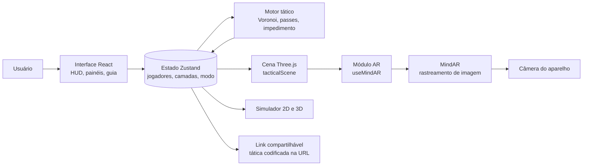
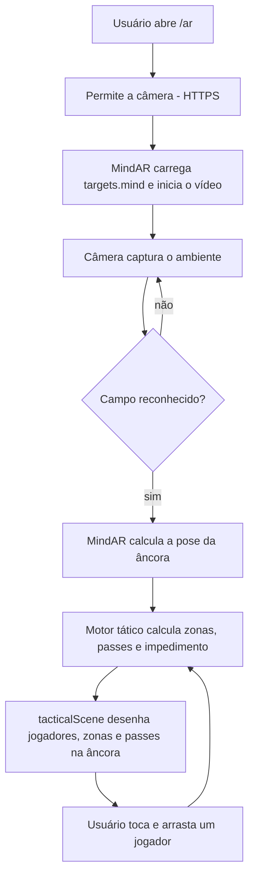
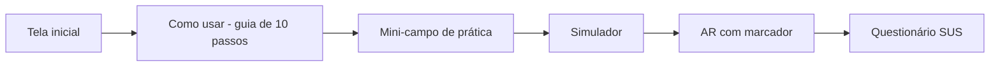

# VoronoiField

**Análise tática de futebol em Realidade Aumentada: aponte o celular para um campo impresso e veja zonas de controle, linhas de passe e impedimento mudando enquanto você move os jogadores.**

[Português](docs/README.pt.md) · [English](docs/README.en.md) · [Español](docs/README.es.md)

- Aplicação publicada: <https://voronoi-field.vercel.app>
- Simulador com guia interativo: <https://voronoi-field.vercel.app/sim?tour=1>
- Marcador para imprimir ou abrir em outra tela: <https://voronoi-field.vercel.app/marcador>
- Licença: AGPL-3.0 (ver [LICENSE](LICENSE))

---

## 1. Identificação do projeto

| Campo | Informação |
| --- | --- |
| Projeto | VoronoiField |
| Equipe | UPX VoronoiField |
| Curso | Engenharia de Computação, Facens |
| Disciplina | UPX, Realidade Aumentada (problemática aplicada) |
| Professor | Prof. Dr. Ohata |
| Semestre | 2º semestre de 2026 |

### Integrantes

| Integrante | RA | Responsabilidade técnica |
| --- | --- | --- |
| Guilherme Savassa Bernal | PREENCHER_RA | Arquitetura e desenvolvimento do aplicativo (React, Three.js, MindAR), motor tático (Voronoi, passes, impedimento), testes automatizados, publicação na Vercel e documentação |
| Felipe Bettoni | PREENCHER_RA | PREENCHER_RESPONSABILIDADE |
| João Victor Chaves Farias | PREENCHER_RA | PREENCHER_RESPONSABILIDADE |

---

## 2. Visão geral

O VoronoiField é um aplicativo web que sobrepõe análise tática de futebol a um campo real, impresso ou aberto em outra tela. A câmera do celular reconhece o campo, e o aplicativo desenha sobre ele os jogadores em 3D, as zonas de controle de cada time, as linhas de passe e a linha de impedimento. O usuário arrasta os jogadores com o dedo e vê o resultado se atualizar na hora.

O problema que o projeto trata é a dificuldade de **enxergar espaço** numa jogada. Quem estuda tática (jogadores, treinadores de base, estudantes e torcedores) costuma depender de prancheta estática ou de vídeo, em que o espaço livre, o passe possível e o impedimento precisam ser imaginados. O aplicativo transforma essas ideias em figuras visíveis e manipuláveis.

A solução funciona assim: o campo é dividido pelo **diagrama de Voronoi**, que atribui cada ponto do campo ao jogador mais próximo, e a soma das áreas de cada time vira o "domínio do campo". Linhas de passe livres ou bloqueadas, o melhor passe do portador e a linha de impedimento saem de cálculos geométricos sobre as mesmas posições.

A Realidade Aumentada entra como a forma de **interagir com a prancheta**: a cena 3D fica presa ao campo impresso, e mover o celular muda o ponto de vista, como se a maquete estivesse sobre a mesa. Como o Voronoi mede proximidade e não posse de bola, o domínio mostrado é uma medida de espaço, não de resultado.

---

## 3. Problema

| Aspecto | Descrição |
| --- | --- |
| Contexto | A análise tática de futebol usa pranchetas, desenhos e vídeos para explicar ocupação de espaço, passes e impedimento. |
| Situação atual | Os materiais são estáticos. Para ver o efeito de mover um jogador, é preciso redesenhar ou imaginar. |
| Dificuldade | Espaço livre, linha de passe e impedimento são conceitos geométricos que o iniciante não enxerga sem apoio visual. |
| Público afetado | Estudantes de tática, jogadores e treinadores de categorias de base, torcedores que querem entender o jogo. |
| Impacto | O aprendizado fica lento e depende de alguém experiente explicando em cima de um desenho. |

---

## 4. Objetivos

**Objetivo geral:** desenvolver um aplicativo de Realidade Aumentada que permita visualizar e manipular, sobre um campo de futebol real, o controle de espaço, as linhas de passe e o impedimento.

**Objetivos técnicos**

- Reconhecer um campo impresso por rastreamento de imagem e ancorar a cena 3D nele.
- Calcular o diagrama de Voronoi e o percentual de domínio de cada time a cada movimento.
- Calcular linhas de passe livres e bloqueadas, o melhor passe e o impedimento.
- Permitir arrastar jogadores com o dedo, tanto no AR quanto no simulador 2D e 3D.
- Oferecer formações e cenários prontos e um resumo em texto da mudança entre duas posições.
- Executar no navegador do celular, sem instalação, por HTTPS.
- Cobrir o motor tático e a interface com testes automatizados.

---

## 5. Público-alvo

| Item | Descrição |
| --- | --- |
| Perfil | Estudantes e praticantes de futebol, treinadores de base e torcedores interessados em tática. |
| Contexto de uso | Em sala de aula ou treino, com o campo impresso numa mesa, ou no celular e no computador pelo simulador. |
| Necessidades | Ver o espaço e os passes mudarem enquanto movem os jogadores, com explicação em linguagem simples. |
| Limitações | Precisam de um celular com câmera e navegador atual. O AR exige boa iluminação e o campo impresso ou em outra tela. |
| Familiaridade | Não é necessário conhecimento técnico. O botão **Como usar** guia o primeiro uso em cerca de 2 minutos. |

---

## 6. Funcionalidades

Legenda: ✅ implementado · 🚧 em desenvolvimento · ⬜ planejado · ❌ cancelado

| ID | Funcionalidade | Descrição | Status |
| --- | --- | --- | --- |
| RF01 | Reconhecer o campo | Rastreia o campo impresso (marcador) pela câmera e ancora a cena nele | ✅ |
| RF02 | Exibir jogadores e bola | Mostra os jogadores e a bola sobre o campo, nos modos 4 x 4 e 11 x 11 | ✅ |
| RF03 | Mover jogadores | Arrastar com o dedo, com recálculo a cada movimento | ✅ |
| RF04 | Controle espacial | Voronoi por time e percentual de domínio de cada lado | ✅ |
| RF05 | Linhas de passe | Passes livres e bloqueados entre companheiros | ✅ |
| RF06 | Melhor passe | Indica o melhor passe do portador da bola | ✅ |
| RF07 | Impedimento | Linha de impedimento e jogadores em posição irregular | ✅ |
| RF08 | Formações e cenários | Cinco formações e cenários prontos (por exemplo, contra-ataque) | ✅ |
| RF09 | Painel Resultado | Compara a posição inicial com a atual e explica a mudança em texto | ✅ |
| RF10 | Compartilhar por link | A posição vai codificada na URL. Salvar jogadas no navegador está em preparação | 🚧 |
| RF11 | Escolher a câmera | Seletor de câmera do aparelho, sem cobrir o placar | ✅ |
| RF12 | Modo apresentação | Tela cheia e texto maior para explicar em sala | 🚧 |
| RF13 | Registrador de medição | Registra FPS, latência e estado do marcador e exporta em CSV, para a coleta de dados do artigo | ⬜ |
| RF14 | Guia "Como usar" | Tour interativo com destaque na tela, mini-campo para praticar e link do questionário SUS | ✅ |
| RF15 | Rastro e mapa de calor | Trilha do movimento dos jogadores e mapa de calor | ✅ |

---

## 7. Requisitos não funcionais

| ID | Categoria | Requisito |
| --- | --- | --- |
| RNF01 | Compatibilidade | Funcionar nos navegadores móveis atuais (Chrome no Android e Safari no iOS) sem instalar nada |
| RNF02 | Desempenho | Manter a fluidez da cena durante o arraste de jogadores (meta de 30 quadros por segundo ou mais em celulares de uso comum) |
| RNF03 | Latência | Atualizar zonas e passes de forma imperceptível ao arrastar (meta abaixo de 100 ms) |
| RNF04 | Estabilidade | Manter a sobreposição alinhada ao campo, sem tremor excessivo ou perda do rastreamento |
| RNF05 | Segurança | Uso da câmera apenas por HTTPS. O vídeo é processado no aparelho e não é enviado a servidores |
| RNF06 | Usabilidade | Primeiro uso guiado e legenda "Como ler esta tela"; avaliação pela escala SUS |
| RNF07 | Acessibilidade | Operação por teclado no simulador e no guia, foco visível, respeito a `prefers-reduced-motion` |
| RNF08 | Portabilidade | Aplicação estática, publicável em qualquer hospedagem com HTTPS |

As metas de desempenho (RNF02 e RNF03) ainda serão medidas com o registrador RF13. Veja a seção 22.

---

## 8. Tecnologias utilizadas

| Tecnologia | Versão | Utilização |
| --- | --- | --- |
| Node.js | 22.x | Ambiente de desenvolvimento, testes e build |
| TypeScript | 6.0 | Linguagem do projeto |
| React | 19.2 | Interface |
| Vite | 8.2 | Servidor de desenvolvimento e build |
| Three.js | 0.185 | Cena 3D (campo, jogadores, zonas, passes) |
| React Three Fiber | 9.7 | Renderização 3D declarativa (simulador e tela inicial) |
| drei | 10.7 | Utilitários do React Three Fiber |
| MindAR (build de produção vendorizado) | — | Rastreamento de imagem para o AR |
| d3-delaunay | 6.0 | Cálculo do diagrama de Voronoi |
| Zustand | 5.0 | Estado global (posições, camadas, modo, passos da jogada) |
| React Router | 7.18 | Rotas `/`, `/sim`, `/ar`, `/marcador` |
| Vitest | 5.0 | Testes automatizados |
| Testing Library | 16.3 | Testes de componentes |
| ESLint | 10 | Análise estática |
| Vercel | — | Hospedagem em HTTPS |
| GitHub e GitHub Actions | — | Controle de versão e integração contínua |

---

## 9. Hardware utilizado

| Equipamento | Sistema | Finalidade |
| --- | --- | --- |
| Computador pessoal (Guilherme) | Windows, PowerShell, Node 22 | Desenvolvimento, testes automatizados e publicação |
| Smartphone | PREENCHER_MODELO | Testes de AR em campo |
| Campo impresso em A4 (ou arquivo aberto em outra tela) | — | Marcador de rastreamento (`public/markers/campo-marcador.png`) |

---

## 10. Arquitetura do sistema



Não há servidor de aplicação nem banco de dados: tudo roda no navegador. A hospedagem entrega apenas arquivos estáticos.

---

## 11. Funcionamento da Realidade Aumentada

**Abordagem:** rastreamento de imagem com marcador (Image Tracking). O marcador é a imagem do campo, `public/markers/campo-marcador.png`, compilada para `public/markers/targets.mind`.

**Tecnologia:** a biblioteca MindAR detecta a imagem no vídeo da câmera e estima a pose (posição e orientação) do campo em cada quadro. O aplicativo cria uma âncora no alvo 0 e pendura nela o grupo 3D da jogada. Quando o alvo é perdido, a cena some; quando é encontrado, ela reaparece com uma animação curta.

**Fluxo**



**Integração no código**

- `src/lib/ar/useMindAR.ts` carrega o MindAR sob demanda, confere se o arquivo do marcador existe e trata os erros de câmera, marcador e biblioteca.
- `src/lib/ar/tacticalScene.ts` monta o grupo 3D (pinos dos jogadores, zonas em volume, arcos de passe, linha de impedimento, gramado) e o atualiza a cada mudança de estado.
- `src/components/ar/ARExperience.tsx` junta câmera, rastreamento, cena e interação de toque (`raycaster` para escolher e arrastar o jogador).

Os mesmos cálculos alimentam o simulador `/sim`, que funciona sem câmera.

---

## 12. Estrutura do projeto

```text
VoronoiField/
├── public/
│   └── markers/              # campo-marcador.png e targets.mind (alvo do AR)
├── src/
│   ├── tactics/              # motor tático puro (sem React), testado
│   ├── state/                # store Zustand
│   ├── lib/
│   │   ├── ar/               # MindAR, cena AR, seletor de câmeras
│   │   └── three/            # textura do campo e estádio 3D
│   ├── components/
│   │   ├── ar/               # tela de AR, dica, seletor de câmera
│   │   ├── sim/              # simulador e seletor de formações
│   │   ├── ui/               # HUD, painéis, tela inicial, marcador, legenda
│   │   ├── three/            # estádio 3D e cena da tela inicial
│   │   └── tour/             # guia "Como usar" e mini-campo
│   ├── tour/                 # texto dos passos do guia
│   └── vendor/mind-ar/       # MindAR vendorizado
├── docs/
│   ├── README.pt.md, README.en.md, README.es.md
│   ├── diagrams/             # diagramas (arquitetura, fluxo)
│   ├── images/               # capturas de tela
│   └── documents/            # artigo e materiais da disciplina
├── vercel.json               # reescrita de rotas para SPA
└── .github/workflows/ci.yml  # lint, testes e build no GitHub Actions
```

---

## 13. Principais módulos e componentes

| Arquivo | Responsabilidade |
| --- | --- |
| `src/tactics/engine.ts` | Voronoi, área por time, linhas de passe, melhor passe e impedimento |
| `src/tactics/formations.ts` | Cinco formações (4-4-2, 4-3-3, 3-5-2, 4-2-3-1, 5-3-2) e criação da partida |
| `src/tactics/scenarios.ts` | Cenários prontos com pergunta tática e o que observar |
| `src/tactics/result.ts` | Compara duas posições e gera o texto do painel Resultado |
| `src/tactics/analysis.ts` | Resumo de análise da posição atual |
| `src/tactics/play.ts` | Passos de uma jogada e reprodução animada |
| `src/tactics/heat.ts` | Mapa de calor e rastros |
| `src/tactics/share.ts` | Codifica e decodifica a tática na URL para compartilhar |
| `src/state/tacticalStore.ts` | Estado global: jogadores, portador da bola, camadas, modo 4 x 4 e 11 x 11 |
| `src/lib/ar/useMindAR.ts` | Inicializa o MindAR, a âncora e trata erros |
| `src/lib/ar/tacticalScene.ts` | Cena 3D tática usada no AR |
| `src/components/ar/ARExperience.tsx` | Tela de AR: câmera, toque e arraste |
| `src/components/sim/SimulatorPage.tsx` | Simulador com campo 2D e 3D e painéis |
| `src/components/tour/GuidedTour.tsx` | Guia "Como usar" com destaque na tela |
| `src/components/tour/MiniBoard.tsx` | Mini-campo de treino do guia, com o motor real |
| `src/lib/config.ts` | Leitura do endereço do questionário SUS (`VITE_SUS_URL`) |

---

## 14. Dependências

Declaradas em [package.json](package.json), instaladas com `npm install`.

- Execução: `react`, `react-dom`, `react-router-dom`, `three`, `@react-three/fiber`, `@react-three/drei`, `d3-delaunay`, `zustand`, `@fontsource/big-shoulders-display`, `@fontsource/ibm-plex-sans`.
- Desenvolvimento: `vite`, `typescript`, `vitest`, `jsdom`, `@testing-library/react`, `@testing-library/jest-dom`, `eslint` (com `eslint-plugin-react-hooks`).
- Externa: [MindAR](https://github.com/hiukim/mind-ar-js) (rastreamento de imagem), incluída em `src/vendor/mind-ar` porque o aplicativo carrega a versão de produção compilada.

---

## 15. Configuração do ambiente

1. Instalar o [Node.js 22](https://nodejs.org/) (inclui o npm).
2. Instalar o [Git](https://git-scm.com/).
3. Clonar o repositório e instalar as dependências:

```bash
git clone https://github.com/Guilherme-Bernal/VoronoiField.git
cd VoronoiField
npm install
```

4. (Opcional) Configurar o link do questionário de usabilidade. Crie um arquivo `.env.local` na raiz com:

```text
VITE_SUS_URL=https://link-do-seu-formulario
```

Sem essa variável, o guia apenas orienta a responder o questionário enviado junto com o link.

---

## 16. Como executar o projeto

```bash
npm run dev
```

Abra <http://localhost:5173>. Outros comandos:

| Comando | O que faz |
| --- | --- |
| `npm run dev` | Servidor de desenvolvimento |
| `npm run build` | Verifica os tipos e gera a versão de produção em `dist/` |
| `npm run preview` | Serve a versão de produção localmente |
| `npm run lint` | Análise estática |
| `npm test` | Executa os testes automatizados uma vez |
| `npm run test:watch` | Testes em modo contínuo |

**Testar o AR no celular:** a câmera só funciona em HTTPS ou em `localhost`. Use o endereço publicado (<https://voronoi-field.vercel.app/ar>) ou um túnel HTTPS para o servidor local. Abra o marcador em <https://voronoi-field.vercel.app/marcador> em outra tela, ou imprima-o em A4.

**Publicação:**

```bash
npx vercel --prod
```

---

## 17. Como utilizar a aplicação

**Simulador (computador ou celular), em `/sim`**

1. Abra a página e toque em **Como usar** para o guia de 2 minutos.
2. Escolha uma formação ou um **cenário pronto**.
3. Arraste os jogadores. O percentual de domínio de cada time muda na hora.
4. Ligue ou desligue as camadas: zonas, passes e impedimento.
5. Leia o painel **Resultado**, que explica a mudança em relação à posição inicial.
6. Use **Compartilhar** para gerar um link com a jogada.

**Realidade aumentada (celular), em `/ar`**

1. Abra `/ar` e toque em **Permitir** quando o navegador pedir a câmera.
2. Aponte para o marcador (campo impresso ou aberto em outra tela), a 25 a 60 cm, com boa luz.
3. Aguarde o campo ser reconhecido. Jogadores e zonas surgem sobre ele.
4. Toque num jogador para dar a bola e arraste para mover.
5. Troque o modo (4 x 4 ou 11 x 11) e os cenários nos menus.
6. Se a imagem vier da câmera errada, use o seletor de câmera.

---

## 18. Diagramas

- Arquitetura: seção 10.
- Fluxo do AR: seção 11.
- Fluxo do primeiro uso:



Arquivos de diagrama exportados ficam em [docs/diagrams](docs/diagrams).

---

## 19. Interface da aplicação

As imagens ficam em [docs/images](docs/images). Telas principais:

| Tela | Finalidade | Principais elementos | Ação do usuário |
| --- | --- | --- | --- |
| Tela inicial (`/`) | Apresentar o projeto e levar ao simulador ou ao AR | Cena 3D do estádio, botões Simulador, AR e Como usar | Escolher por onde começar |
| Simulador (`/sim`) | Montar e analisar posições | Campo 2D e 3D, barra de domínio, camadas, cenários, Resultado | Arrastar jogadores e comparar |
| AR (`/ar`) | Analisar sobre o campo real | Vídeo da câmera, cena 3D, placar, menus | Apontar para o marcador e mover jogadores |
| Marcador (`/marcador`) | Exibir ou imprimir o campo de rastreamento | Imagem do marcador em tela cheia | Abrir em outra tela ou imprimir |
| Guia "Como usar" | Ensinar o uso em cerca de 2 minutos | Destaque na tela, mini-campo, botão do questionário | Avançar, praticar e responder o SUS |

> PREENCHER_IMAGENS: adicionar as capturas em `docs/images/` e inseri-las aqui com ``.

---

## 20. Testes técnicos

**Testes automatizados** (`npm test`, Vitest):

| Área | Verificação | Status |
| --- | --- | --- |
| Motor tático | Voronoi, áreas, linhas de passe, melhor passe, impedimento | ✅ |
| Formações e cenários | Número de jogadores, posições válidas, cenários coerentes | ✅ |
| Mapa de calor e rastros | Construção da grade e acúmulo de trilhas | ✅ |
| Estado (Zustand) | Jogada em passos, rastros, mudança de modo | ✅ |
| Cena AR | Opções de camadas, estilo, gramado e animações | ✅ |
| Interface | Legenda, seletor de modo, painel Resultado | ✅ |
| Guia "Como usar" | Abrir, navegar, fechar com Esc, link do SUS só no último passo, mini-campo | ✅ |

A integração contínua (GitHub Actions) roda lint, testes e build a cada envio.

**Testes de campo** (execução manual em celular):

| Teste | Procedimento | Resultado esperado | Resultado obtido | Status |
| --- | --- | --- | --- | --- |
| Câmera | Abrir `/ar` e permitir a câmera | Vídeo aparece | PREENCHER | ⬜ |
| Reconhecimento | Apontar para o marcador | Campo detectado | PREENCHER | ⬜ |
| Cena 3D | Detectar o alvo | Jogadores e zonas surgem | PREENCHER | ⬜ |
| Interação | Arrastar um jogador | Zonas e percentual atualizam | PREENCHER | ⬜ |
| Perda de alvo | Tirar o marcador do campo de visão | Cena some e volta ao reencontrar | PREENCHER | ⬜ |

---

## 21. Dispositivos testados

| Dispositivo | Sistema | Versão | Resultado |
| --- | --- | --- | --- |
| PREENCHER_MODELO | PREENCHER_SISTEMA | PREENCHER_VERSAO | PREENCHER_RESULTADO |

Só devem constar aparelhos em que o AR foi realmente executado.

---

## 22. Limitações conhecidas

- O AR depende do marcador (campo impresso ou aberto em outra tela) e perde o rastreamento com pouca luz, reflexo ou ângulo muito inclinado.
- A câmera exige HTTPS; sem isso o navegador bloqueia o acesso.
- O domínio do campo mede **proximidade**, não posse de bola nem qualidade do passe.
- O aplicativo não recebe dados reais de partidas: as posições são montadas pelo usuário.
- O registrador de medição (RF13) ainda não existe; as metas de desempenho estão por medir.
- O modo apresentação e o salvamento de jogadas no navegador (RF10 e RF12) estão em preparação.
- Os testes em aparelhos reais ainda precisam ser concluídos e registrados (seções 20 e 21).
- O desempenho em celulares antigos no modo 11 x 11 não foi medido.

---

## 23. Evidências de funcionamento

- Aplicação publicada e funcional: <https://voronoi-field.vercel.app>
- Histórico de commits no GitHub mostrando a evolução do projeto.
- Integração contínua com lint, testes e build.

> PREENCHER_EVIDENCIA: incluir ao menos uma captura, GIF ou vídeo do AR funcionando (por exemplo, em `docs/images/ar-funcionando.gif`) e o link do vídeo, se publicado.

---

## 24. Problemas encontrados e soluções

**Problema:** a integração contínua falhava com o `jsdom`.
**Causa:** o Node usado no CI era incompatível com a versão do `undici` exigida pelo `jsdom`.
**Solução:** fixar o Node 22 no workflow do GitHub Actions.

**Problema:** no servidor de desenvolvimento, o AR dava a impressão de carregar o marcador mesmo quando o arquivo não existia.
**Causa:** o servidor devolve `index.html` com status 200 para caminhos inexistentes, e a biblioteca tentava ler esse HTML como marcador.
**Solução:** `useMindAR` confere o tipo do conteúdo (`content-type`) antes de iniciar e mostra uma mensagem de marcador ausente.

**Problema:** acessar `/sim` ou `/ar` diretamente na versão publicada dava erro 404.
**Causa:** a Vercel procurava um arquivo por rota, mas o aplicativo é de página única.
**Solução:** `vercel.json` com reescrita de todas as rotas para `index.html`.

**Problema:** os goleiros se comportavam como jogadores de linha em alguns cálculos e cenários.
**Causa:** os identificadores A11 e B11 não eram tratados como goleiros.
**Solução:** função `isGoalkeeper` no motor e correção dos cenários prontos.

**Problema:** a dica inicial do AR cobria o guia "Como usar".
**Causa:** as duas camadas abriam ao mesmo tempo.
**Solução:** a dica não abre quando a página é aberta com `?tour=1`.

**Problema:** o cartão do guia escondia o item destacado em telas pequenas.
**Causa:** o cartão ficava sempre na parte de baixo.
**Solução:** o cartão passa a ficar do lado com mais espaço livre em relação ao destaque.

---

## 25. Cronograma técnico

| Atividade | Responsável | Status |
| --- | --- | --- |
| Definição da ideia e pesquisa de RA | Equipe | ✅ |
| Prova de conceito do motor tático (Voronoi e passes) | Guilherme | ✅ |
| Simulador 2D e 3D | Guilherme | ✅ |
| Rastreamento por marcador (MindAR) e seletor de câmera | Guilherme | ✅ |
| Cena AR 3D, impedimento, melhor passe, placar | Guilherme | ✅ |
| Cenários, painel Resultado e modo 4 x 4 | Guilherme | ✅ |
| Guia "Como usar" e questionário SUS | Guilherme | ✅ |
| Modo apresentação e jogadas salvas | Guilherme | 🚧 |
| Registrador de medição (RF13) | Guilherme | ⬜ |
| Testes em aparelhos reais e coleta de dados | Equipe | 🚧 |
| Artigo científico | Equipe | 🚧 |
| Documentação (este README) | Equipe | 🚧 |

---

## 26. Controle de versão

- Repositório: <https://github.com/Guilherme-Bernal/VoronoiField>
- Ramo principal: `main`. Funcionalidades maiores são desenvolvidas em ramos próprios e integradas depois.
- Os commits são pequenos e descrevem a mudança (por exemplo, "Painel de Resultado, cenarios prontos e correcao do goleiro" e "Guia interativo Como usar").
- Integração contínua: `.github/workflows/ci.yml`.

Padrão de mensagens recomendado daqui em diante:

```text
feat: implementa registrador de medição
fix: corrige posicionamento do objeto 3D
docs: atualiza procedimentos de instalação
test: adiciona validação em dispositivo Android
```

---

## 27. Licença

AGPL-3.0. Quem modificar este projeto e o disponibilizar por rede (inclusive uma versão web pública) deve disponibilizar também o código-fonte modificado. Ver [LICENSE](LICENSE).
